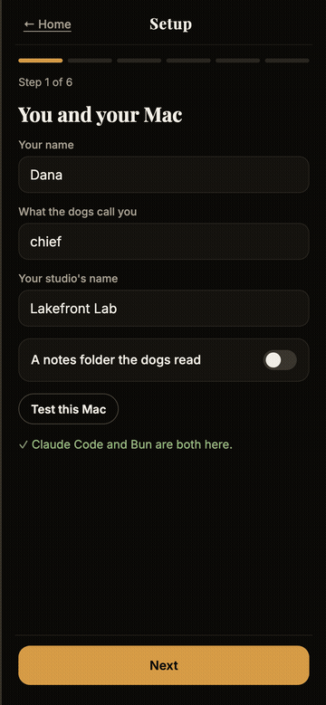
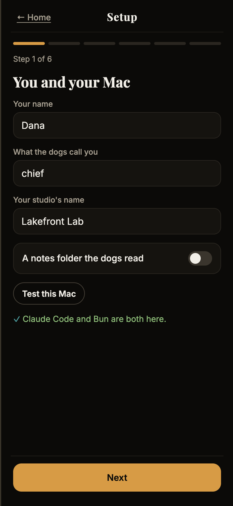
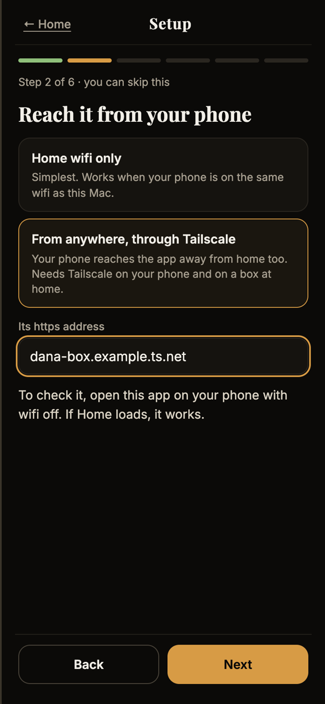
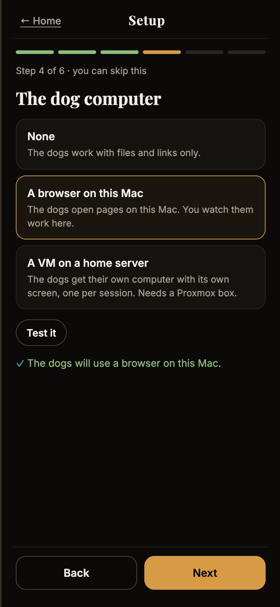
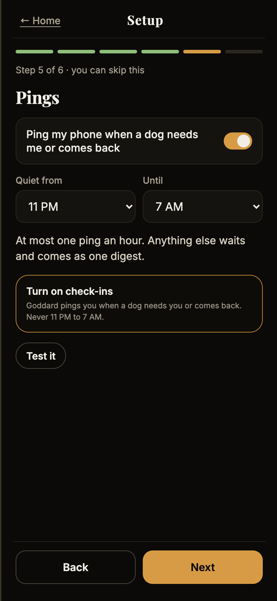
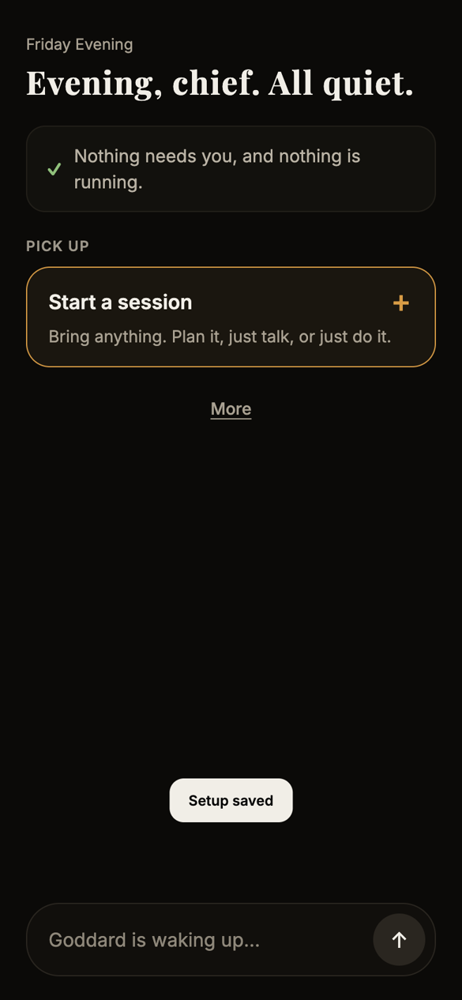
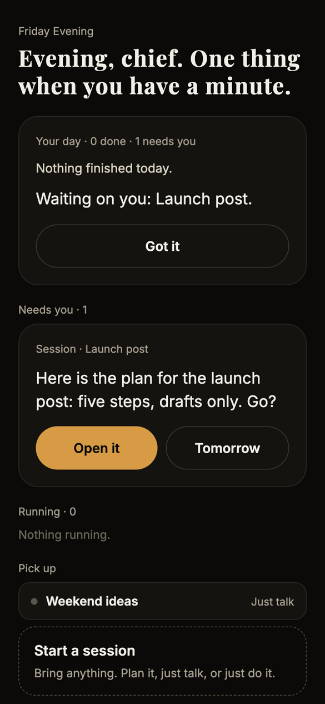
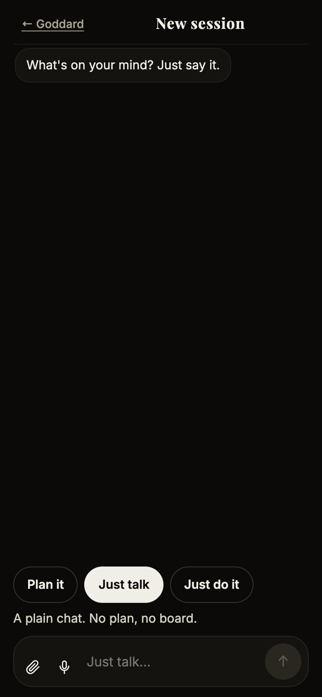
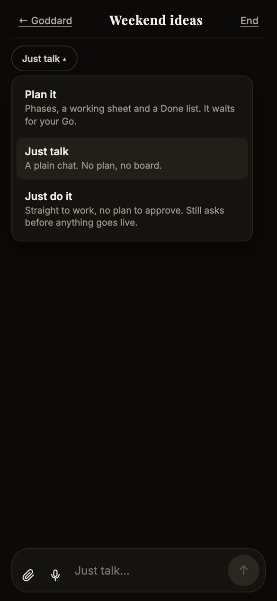

# Goddard OS (pilot)

Made by GM! Carl.

A calm phone home for your Claude Code background sessions. You give jobs to named helpers ("dogs"), approve each
plan with one tap, and get one ping when something needs you. It runs on your Mac; your phone opens it in the browser.

<p align="center"></p>

## Install

In Claude Code on your Mac, paste these one at a time:

```
/plugin marketplace add crafty-arl/goddard-os-plugin
```
```
/plugin install goddard-os@goddard-os
```
```
/goddard-os:start
```

The first start installs what it needs, signs this Mac's browser in, and opens Setup: six short steps (you, your
phone, your dogs, a dog computer, pings, more connections). Every step after the first can be skipped. Nothing starts
a Claude session until Setup is saved.

**Full walkthrough:** [docs/SETUP.md](docs/SETUP.md) covers every Setup step, getting your phone in, passkeys, pings,
and what to do when something goes wrong.

## What Setup looks like

Six steps, one at a time, each with a test button. Only the first one is required.

| You and your Mac | Your phone | The dog computer | Pings |
| --- | --- | --- | --- |
|  |  |  |  |

## After Setup

| Home | Something needs you | Pick a mode | Switch a chat's mode |
| --- | --- | --- | --- |
|  |  |  |  |

Every session has a mode: **Plan it** (phases, a working sheet, a Done list, and it waits for your Go), **Just talk**
(a plain chat), or **Just do it** (straight to work, but anything public still stops for your OK). Screenshots are from a
demo install with a made-up owner.

## Needs

- A Mac with Claude Code on a paid plan. Background helpers use your plan's limits fast.
- Bun and Node.
- For your phone away from home: Tailscale.

`/goddard-os:stop` stops it. Your profile, passkeys and boards live in `~/.claude/channels/gm-chat`, so updates keep them.

## For the maintainer

`./bundle.sh` copies the app and the door into `plugin/` from their repos (tracked files only).
`bun run test` bundles and runs the install tests: a fresh install on spare ports, with a stand-in for Claude so no
real session starts.

## How the screenshots are made

The screenshots and the GIF are made by a script, not by hand, so they always show the current app and never anyone's
real data:

```
bun install
bun run screenshots
```

[`scripts/screenshots.ts`](scripts/screenshots.ts) does this:

1. Starts the bundled app on spare ports with an empty, temporary state folder, so it never touches a real install.
   Claude is replaced by a stand-in that starts no sessions.
2. Opens a headless, phone-sized browser (390 × 844, dark mode), signs it in, and walks Setup as a made-up owner
   ("Dana" at "Lakefront Lab"), taking a screenshot at each step.
3. Adds two stand-in chats, a plan waiting for Go and a Just talk chat, to show Home and the mode switch.
4. Saves the PNGs to `docs/screens/`, builds `docs/demo.gif` with ffmpeg, then stops everything and deletes the
   temporary folder.

It needs Bun, Node, ffmpeg (`brew install ffmpeg`) and a Chromium for Playwright (`bunx playwright install chromium`,
or point `CHROME_PATH` at a Chrome). Run it again after any change to the screens.

## License

MIT. See LICENSE.
