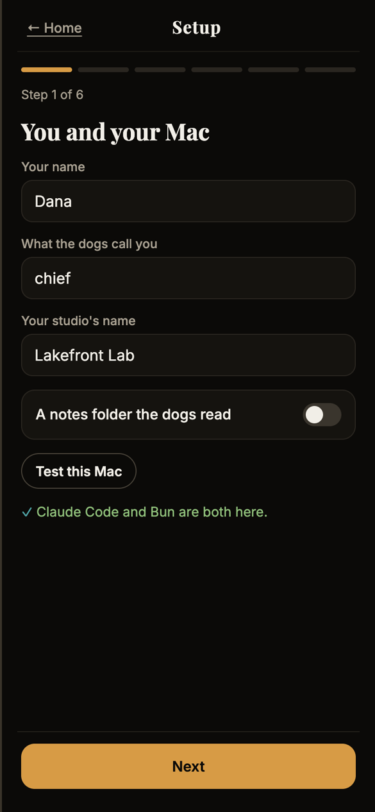
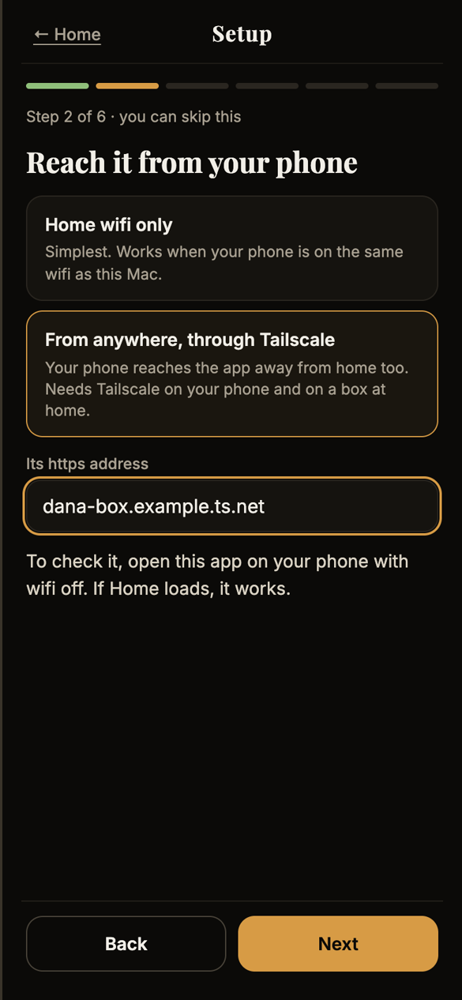
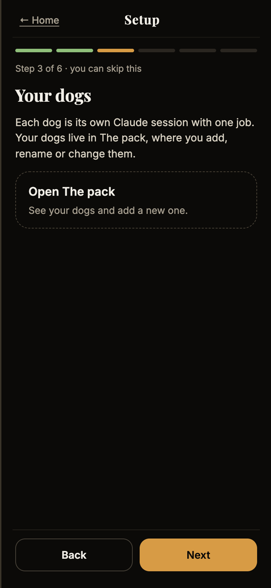
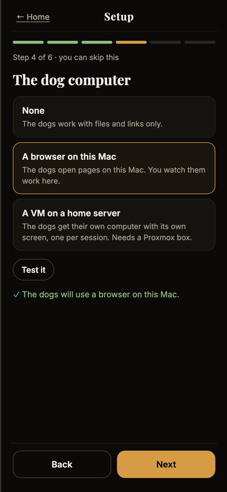
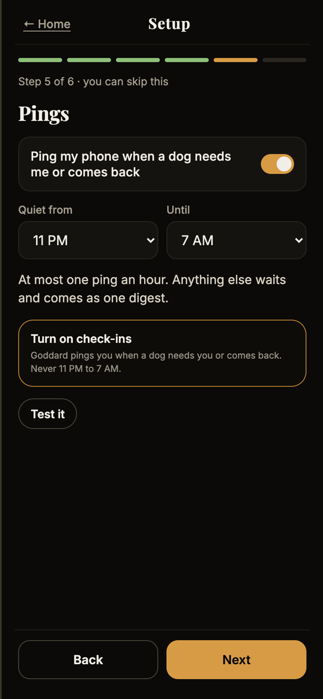
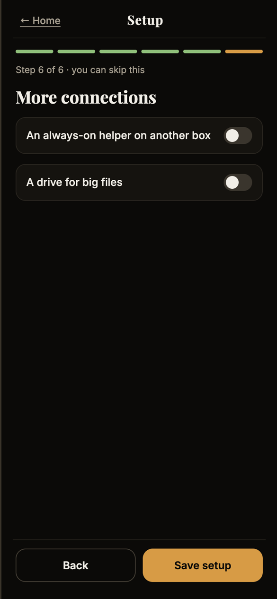
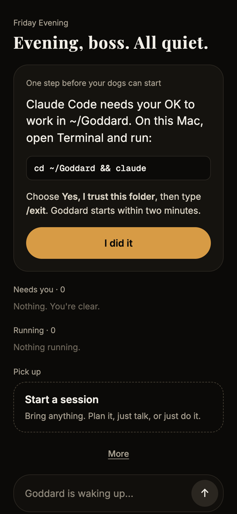
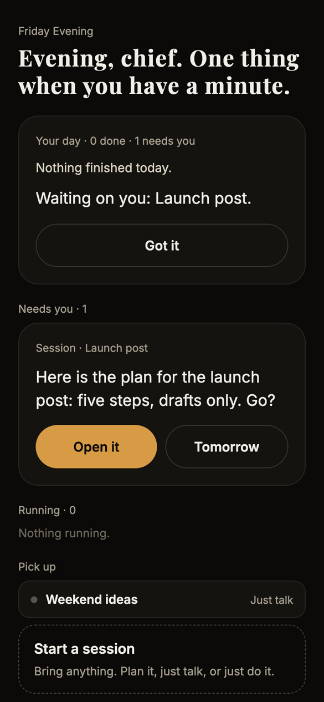

# Setting up Goddard OS

This walks through a new install from nothing to your first chat. It takes about ten minutes. Only step 1 of Setup is
required; you can come back to the rest any time from **More → Setup**.

## Before you start

You need:

- **A Mac.** Goddard OS runs on your Mac and your phone opens it in the browser.
- **Claude Code on a paid Claude plan** (the command-line version; see below if you use the desktop app). Each helper ("dog") is its own Claude Code session running in the background,
  and they use up your plan's limits fast.
- **Bun:** paste `curl -fsSL https://bun.sh/install | bash` into Terminal.
- **Node:** install it from [nodejs.org](https://nodejs.org).

## 1. Install

In Claude Code on your Mac, paste these one at a time:

```
/plugin marketplace add crafty-arl/goddard-os-plugin
```
```
/plugin install goddard-os@goddard-os
```
```
/goddard-os:start
```

The last one checks that Claude Code, Bun and Node are there and tells you exactly what's missing if they aren't. Then it
installs what it needs, starts Goddard OS, and opens your browser already signed in, on Setup.

Nothing starts a Claude session until you save Setup.

### Using the Claude desktop app?

The `/plugin` commands only work in Claude Code in a terminal, so they won't pop up in the desktop app. Use Terminal
instead (open it from Spotlight). Paste these one at a time:

1. Install Claude Code's command line. Goddard OS's helpers run on it, even if you chat in the desktop app:
   ```
   curl -fsSL https://claude.ai/install.sh | bash
   ```
2. Run `claude` once, sign in with your Claude account, then type `/exit`.
3. Add and install the plugin:
   ```
   claude plugin marketplace add crafty-arl/goddard-os-plugin
   ```
   ```
   claude plugin install goddard-os@goddard-os
   ```
4. Start it. Your browser opens on Setup:
   ```
   bash ~/.claude/plugins/marketplaces/goddard-os/plugin/bin/goddard.sh start
   ```

Use the same line with `stop` at the end to stop it, and run it again after the Mac restarts.


## 2. Setup, step by step



### Step 1: You and your Mac (required)

- **Your name** is the only required field.
- **What the dogs call you**, for example "chief" or your first name. Home greets you with it.
- **Your studio's name** (optional). The dogs use it when they write for you.
- **A notes folder the dogs read** (optional). Point it at a folder of notes about you and your work, and the dogs
  read it for context. Home also runs in that folder. Without one, Home and the dogs work in `~/Goddard`.
- **Test this Mac** checks that Claude Code and Bun are installed.

<br clear="right">



### Step 2: Reach it from your phone

- **Home wifi only** is the simplest choice. On your phone, open `http://<your Mac's IP address>:5173`. You'll find the IP
  address in System Settings → Wi-Fi → Details. Use the number, not the Mac's name.
- **From anywhere, through Tailscale** works away from home too. Install Tailscale on your Mac and your phone, then run
  `tailscale serve --bg 5173` on the Mac. Tailscale gives you an `https://…ts.net` address: type it into **Its https
  address**, save Setup, and run `/goddard-os:stop` and then `/goddard-os:start` so the app allows it.

**Signing your phone in the first time:** on the Mac, run `cat ~/.claude/channels/gm-chat/link.txt` in Terminal. Send
that link to yourself (AirDrop, Notes) and paste it into the **Locked** screen on your phone. Treat the link like a
password. Once you're on the https address, you can switch to passkeys (see [Sign-in](#sign-in-with-passkeys) below).

<br clear="right">



### Step 3: Your dogs

Each dog is its own Claude session with one job, such as writing copy, research or planning a campaign. A new install
starts with an empty pack. **Open The pack** to add one: give it a name and one line about its job, and Goddard drafts
its full role for you to read and edit before it wakes up.

You can skip this step. When you ask Home for something no dog does yet, Home suggests a new dog and only makes it if
you say yes.

<br clear="right">



### Step 4: The dog computer

Choose where the dogs can use a computer:

- **None:** the dogs work with files and links only.
- **A browser on this Mac:** the dogs open pages on this Mac.
- **A VM on a home server:** the dogs get their own computer with its own screen, one per chat. This needs a Proxmox
  box: type the server as `user@address`, the VM's address, and how many screens can run at once.

**Test it** checks the choice (for a VM, it connects over SSH with this Mac's key).

<br clear="right">



### Step 5: Pings

- Choose your **quiet hours**. Goddard OS sends at most one ping an hour, and anything else waits for the next digest.
  At 6 PM you get one "what got done" ping, plus a card on Home.
- **Turn on check-ins** signs up the device you're holding. Do it from your phone: on an iPhone, first open the
  https address in Safari and use **Share → Add to Home Screen**, because iPhones only allow notifications from
  home-screen apps.
- **Test it** tells you how many phones are signed up.

<br clear="right">



### Step 6: More connections

Both are optional:

- **An always-on helper on another box:** if you run your own assistant on a home server, give its address and Home
  can hand it jobs.
- **A drive for big files:** where it mounts, for example `/Volumes/MyDrive`. The dogs can read it and add files,
  but deleting or overwriting anything there asks you first.

Tap **Save setup**. Home opens.

<br clear="right">



### One last step: let Claude Code work in your folder

The first time, Home shows **One step before your dogs can start**. Claude Code only runs background sessions in a
folder you've said it may use, and only you can say yes. On the Mac, open Terminal and run the line Home shows, for
example:

```
cd ~/Goddard && claude
```

Choose **Yes, I trust this folder**, type `/exit`, and tap **I did it**. Goddard, the main chat, starts within two
minutes. **Test this Mac** in Setup step 1 checks this too.

<br clear="right">

## 3. Using it



**Home** shows three lists: **Needs you** (a plan waiting for your Go, a question, or something to review), **Running**,
and **Pick up** (unfinished chats). From 6 PM, a card at the top sums up the day.

**Start a session** and pick a mode:

- **Plan it:** phases, a working sheet and a Done list. It waits for your Go before it starts.
- **Just talk:** a plain chat.
- **Just do it:** straight to work, with no plan to approve.

The menu at the top of a chat switches its mode at any time. In every mode, anything that would go public, cost money
or change a live system stops and asks you first.

<br clear="right">

### Sign-in with passkeys

On the https address, go to **More → Sign-in** and tap **Add a passkey for this device** (Face ID or Touch ID). Do the
same on each device you use. Once they all have one, turn **The password link** off. After that, only devices on the
list can get in, and removing a device signs it out at once.

## Day to day

- **Stop it:** `/goddard-os:stop`. The dogs' conversations are kept.
- **After the Mac restarts:** run `/goddard-os:start` again.
- **Where your things live:** `~/.claude/channels/gm-chat` (your profile, passkeys and chats). Updating the plugin
  keeps them.
- **Logs:** `~/Library/Logs/goddard-os.log`.

## If something goes wrong

| What you see | What to do |
| --- | --- |
| `✕ Bun is missing` (or Node, or Claude Code) | Install what it names, then run `/goddard-os:start` again. |
| The **Locked** screen on the Mac | Run `/goddard-os:start` again. It signs this Mac's browser in. |
| "Goddard is waking up…" for more than two minutes | Do the one-time trust step above (Home shows the exact line). |
| `✕ Another app is using port 5173` | Close that app (often another project's dev server), then run `/goddard-os:start` again. |
| "Blocked request" on your phone | Use the Mac's IP address, not its name. For an https address, put it in Setup step 2 and restart. |
| Setup's **Test it** shows ✕ | It says what's wrong in plain words, such as "The host should look like user@address." Fix that and test again. |
| The app didn't start | Look in `~/Library/Logs/goddard-os.log`. |
